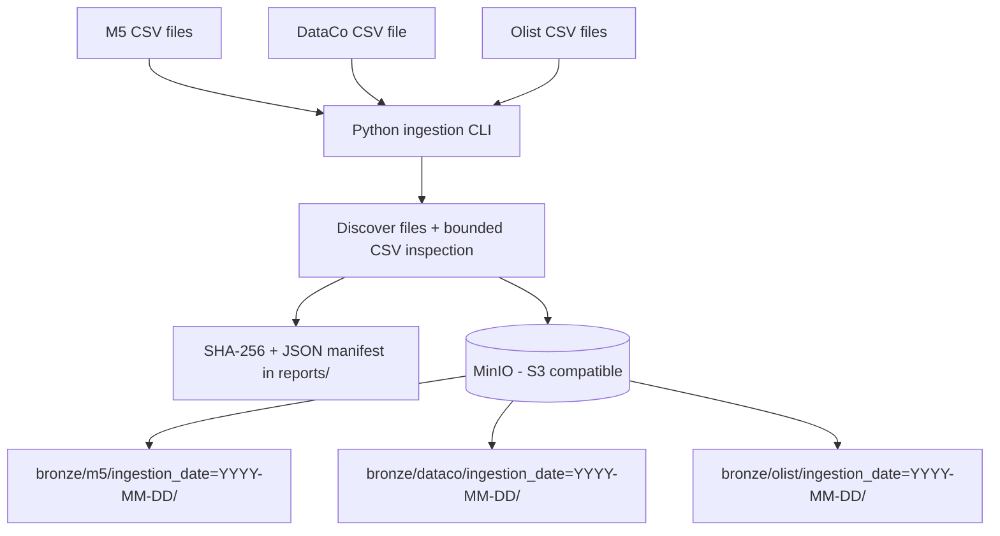

# SupplyChain 360

**Global supply chain intelligence, forecasting and inventory optimisation platform**

**Author:** Dhanush · **License:** MIT ·  


SupplyChain 360 is a portfolio data-engineering and analytics project. The goal is a **decision-support
control tower**: connect sales, orders, inventory, suppliers and shipments; forecast demand with
uncertainty; recommend inventory policies; and simulate disruptions. -


## Architecture 



**Bronze principle:** preserve source files byte-for-byte. No header, type, encoding or value changes.
Transformations belong to later layers.

## Quick start

### Prerequisites

- Python 3.10+ and Git
- Docker Desktop (Docker Compose) — only needed to run against MinIO
- 10–15 GB free disk **only if** you download the real datasets

### 1. Install

```bash
python -m venv .venv
source .venv/bin/activate          # Windows PowerShell: .venv\Scripts\Activate.ps1
python -m pip install --upgrade pip
python -m pip install -e ".[dev]"
cp .env.example .env               # Windows PowerShell: copy .env.example .env
```

The credentials in `.env.example` are **local development defaults**. Never reuse them for anything public
and never commit `.env`.

### 2. Run the tests (no Docker needed)

```bash
make test        # or: pytest -q
make lint        # or: ruff check .
```

### 3. Demo with synthetic data (needs Docker)

```bash
make up          # start MinIO  (console: http://localhost:9001, login minioadmin / minioadmin)
make demo        # ingest data/sample/ -> bronze/
```

Expected result: 10 objects in bucket `supplychain360-lake` under `bronze/`, and a manifest at
`reports/<today>/ingestion_manifest.json`.

### 4. Ingest the real datasets

Download the datasets yourself (see [`docs/dataset_licenses.md`](docs/dataset_licenses.md)), place them as
below, then run `make ingest`.

```text
data/raw/
├── m5/      sales_train_validation.csv  calendar.csv  sell_prices.csv
├── dataco/  DataCoSupplyChainDataset.csv
└── olist/   olist_orders_dataset.csv  olist_order_items_dataset.csv  olist_products_dataset.csv
             olist_customers_dataset.csv  olist_sellers_dataset.csv  olist_order_payments_dataset.csv
             olist_order_reviews_dataset.csv  olist_geolocation_dataset.csv
             product_category_name_translation.csv
```

Options: `python -m supplychain360.cli --date 2026-11-16` pins the partition date;
`--config <file>` selects another registry; `INGESTION_DATE` in `.env` is also honoured.
Invalid dates or a missing config exit with code 2 and a clear message.

### 5. Verify

1. Open http://localhost:9001 and check `bronze/` in bucket `supplychain360-lake`.
2. Compare `sha256` and `size_bytes` in `reports/<date>/ingestion_manifest.json` with the local files.
3. Confirm `missing_expected_files` is empty for every source you consider complete.

Optional CLI check: `mc alias set local http://localhost:9000 minioadmin minioadmin && mc ls --recursive local/supplychain360-lake/bronze/`

## Repository layout

```text
supplychain360/
├── .github/workflows/tests.yml      # CI: lint + tests on Python 3.10-3.12
├── config/
│   ├── datasets.yaml                # real-dataset registry
│   └── datasets.sample.yaml         # demo registry (synthetic sample)
├── data/
│   ├── raw/                         # real datasets go here (git-ignored)
│   └── sample/                      # tiny SYNTHETIC sample (committed)
├── docs/
│   ├── business_requirements.md     # problem, objectives, user stories, KPIs
│   ├── architecture.md              # decisions and limits
│   ├── adr/                         # architecture decision records 0001-0004
│   ├── dataset_licenses.md          # sources, licences, attribution
│   ├── data_inventory.md            # fill in after your first real run
│   ├── runbook.md                   # operate / recover
│   └── definition_of_done.md        # evidence-based completion checklist
├── scripts/generate_sample_data.py  # deterministic synthetic sample generator
├── src/supplychain360/              # cli.py, config.py, ingest.py, inspection.py, storage.py
├── tests/                           # unit + S3-server integration tests
├── docker-compose.yml               # MinIO
└── Makefile  pyproject.toml  .env.example  LICENSE  CHANGELOG.md
```


## Data and licensing

Raw datasets are **not** in this repository: they are large and carry their own terms. The Olist dataset is
reported as CC BY-NC-SA 4.0 (non-commercial) — confirm on its Kaggle page. Full details and attribution:
[`docs/dataset_licenses.md`](docs/dataset_licenses.md). Files in `data/sample/` are synthetic.

## Author

Built and maintained by **Dhanush**.

## License

MIT — see [`LICENSE`](LICENSE). 
